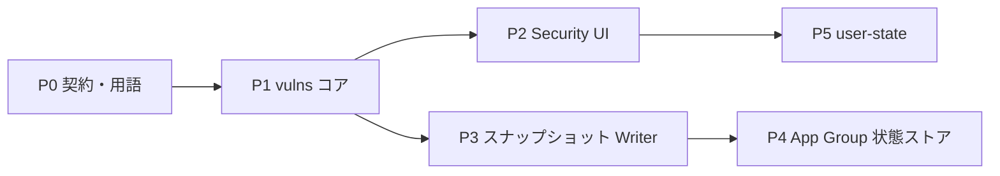

# docs_mod — 仕様ドラフト (Issue `#21` / `#22`)

本ディレクトリは、**正本 `docs/` に取り込む前の検討用** 仕様です。実装着手前にここで契約・用語・段階を固定し、手戻りを抑えます。

| Issue | 題材 | ドラフト |
| --- | --- | --- |
| [#22](https://github.com/stein2nd/s2j-cozy-brew/issues/22) | インストール済み Formula の `brew vulns` 取得・表示 | [brew-vulns-spec.md](brew-vulns-spec.md) |
| [#21](https://github.com/stein2nd/s2j-cozy-brew/issues/21) | 他アプリとのメンテナンス状態共有 — **App Group を状態マシン (正本)** | [maintenance-sharing-spec.md](maintenance-sharing-spec.md) |

**連携先:** [S2J CLI Manager](https://github.com/stein2nd/s2j-cli-manager) (Homebrew 行は CozyBrew 管轄。npm / Composer audit と件数合算しない)。

---

## 手戻り最小化の実装順 (推奨)

以下の順で進めると、`#22` 単体 UI を作ったあと `#21` でスキーマや件数定義を書き直す手戻りを避けられます。

| 段階 | 内容 | 主な成果物 |
| --- | --- | --- |
| **P0** | 件数定義・用語対照・`BrewMaintenanceSnapshot` **schema v1** (vulns は null 可)、**仮称** (`S2JMaintenanceKit` 等) 固定 | App Group パス、SPI 境界のドラフト |
| **P1** | `brew vulns --json`、`BrewVulnsParser`、`refreshSecuritySnapshot()`、キャッシュ | `BrewManager` / Core、`BrewVulnsParser` テスト |
| **P2** | サイドバー **Security**、Warnings とは別バッジ・画面 | `ux_flows_spec` 追記候補 |
| **P3** | Refresh 成功時の **スナップショット原子的書き込み** + **delta** (outdated / doctor 含む) | `MaintenanceSnapshotWriter` |
| **P4** | **App Group** Entitlements、仮称 Kit で [S2J CLI Manager](https://github.com/stein2nd/s2j-cli-manager) 読取、Custom URL (仮) | 状態ストア本番化 |
| **P5** | `user-state.json` (acknowledged / fingerprint) | CozyBrew が brew 系 fingerprint を更新 |

**原則:** P1の時点で `vulnerableFormulaCount` 等は **UI、スナップショット、将来 [S2J CLI Manager](https://github.com/stein2nd/s2j-cli-manager) が同じ関数** から導出するよう、パース結果 → 集計ロジックを **1ヵ所** に置く (`BrewDoctorParser` と同型)。

---

## 正本 `docs/` への昇格条件

| ドラフト | 昇格先 (予定) |
| --- | --- |
| `brew-vulns-spec.md` § CLI / パース / Refresh | `docs/brew_integration_spec.md` 新規 § `brew vulns` |
| 用語対照・件数定義 | `docs/SPEC.md` または `docs/security_spec.md` |
| スナップショット JSON | 新規 `docs/maintenance_snapshot_spec.md` (または integration 節) |
| サイドバー、Refresh 振る舞い | `docs/ux_flows_spec.md` §3追記 |

昇格時は `npm run docs:heading-tags` の対象に `docs_mod/` と同 stem を追加するか、正本側にマージして `docs_mod` をアーカイブします。

---

## 現行実装との差分 (要点)

| 領域 | 現状 | 本ドラフト後 |
| --- | --- | --- |
| 脆弱性 | なし | `brew vulns --json` 正本 |
| Warnings | `brew doctor` のみ | **混同禁止** ([用語表](brew-vulns-spec.md#2-用語対照warnings--security)) |
| ツールバー Refresh | `refreshApplicationState()` | vulns は **含めない**。Security タブで `refreshSecuritySnapshot()` |
| 他アプリ | なし | App Group 内 `maintenance-snapshot.json` 読取 |

**`#21` 確定事項:** 状態の正本は App Group (§ [maintenance-sharing-spec.md §1–2](maintenance-sharing-spec.md))。`S2JMaintenanceKit` / `S2JCollaboration` 等の名称は **仮**。
