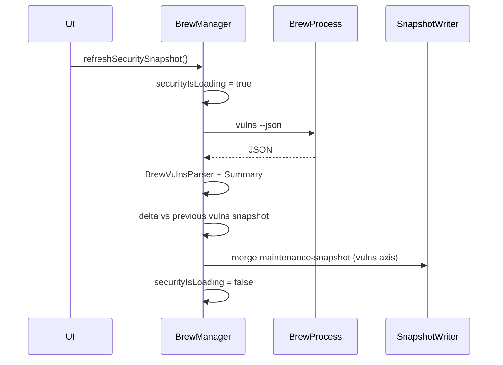

# S2J CozyBrew — Issue `#22`: インストール済み Formula の脆弱性 (`brew vulns`)

> **状態:** ドラフト (`docs_mod`)。GitHub [#22](https://github.com/stein2nd/s2j-cozy-brew/issues/22)。  
> **関連:** [#21 他アプリ連携](maintenance-sharing-spec.md) — 件数、`delta`、fingerprint は **App Group 上の同一契約** で公開 (Kit / SPI 名は仮)。

---

## 1. 目的と非目標

### 1.1. 目的

* インストール済み **Formula** に対する既知の脆弱性を、Homebrew 公式の **`brew vulns --json`** を正本として取得・表示する。
* **`brew doctor` (環境 Warnings) と UI、用語、件数を混同しない**。
* スキャンは **重い・ネットワーク必須** のため、`refreshApplicationState()` から **切り離し**、完了まで **前回結果** を表示する。
* [#21](maintenance-sharing-spec.md) の `BrewMaintenanceSnapshot` に vulns 軸を載せ、[S2J CLI Manager](https://github.com/stein2nd/s2j-cli-manager) が **読み取り専用** で Homebrew 行を表示できる。

### 1.2. 非目標 (v1)

* **Cask** の脆弱性スキャン (`brew vulns` 公式ヘルプ: Cask は非対象)。
* `brew audit` を CVE 監査としての利用。
* [S2J CLI Manager](https://github.com/stein2nd/s2j-cli-manager) 側での `brew vulns` 独自実行 (canonical は CozyBrew)。
* npm / Composer audit との **合算バッジ**。

---

## 2. 用語対照 (Warnings ≠ Security)

| ユーザー向けラベル | brew コマンド | 意味 | 現行 UI |
| --- | --- | --- | --- |
| **Warnings** | `brew doctor` | 環境・設定の診断メッセージ | サイドバー最上位、オレンジバッジ |
| **Security** / **Vulnerabilities** | `brew vulns` | OSV.dev ベースの **CVE/GHSA** | **新規** (doctor バッジを流用しない) |
| Outdated | `brew outdated` | 新版あり | 既存 |
|  (補助、v1非必須) | `brew outdated --vulnerable` | Outdated **かつ** 脆弱性あり | 本 Issue の主指標にしない |

`brew audit` は Formula **メンテナー向けスタイル監査** であり、本機能と **無関係** とします。

---

## 3. 件数定義 (固定)

**UI、`BrewManager`、スナップショット、[S2J CLI Manager](https://github.com/stein2nd/s2j-cli-manager) は、同一定義のみを使います。** 集計は `BrewVulnsSummary` (仮称) の **単一関数** から導出します。

| 名称 | 定義 | 用途 |
| --- | --- | --- |
| `vulnerableFormulaCount` | `findings` のうち、未パッチの `vulnerabilities` が **1件以上** ある **formula 数** (`patched` のみの行は数えない) | サイドバーバッジ、ダッシュボード |
| `openVulnerabilityCount` | 上記 formula に属する **オープン** vulnerability エントリの **合計** | 詳細ヘッダー、サマリー |
| `checkedFormulaCount` | JSON の `checked` | カバレッジ表示 |
| `complete.vulnsScan` | JSON の `complete == true` | スナップショット、UI の「完全スキャン」表示 |
| `delta.vulnerableFormulaeAdded` / `Removed` | 前回 **成功した vulns スキャン** の vulnerable formula **名前集合** の差分 | 「新規発生」(canonical) |

※ `openVulnerabilityCount` ≥ `vulnerableFormulaCount` になりうる (1 `formula` に複数 CVE)。

### 3.1. `patched` の扱い

`findings[].patched` / `findings[].vulnerabilities` の関係は **Homebrew の JSON 正本** に従い、パーサー内で「オープン」とみなす条件をテストで固定します。  
`--no-ignore-patches` は、v1では **付けません** (デフォルトの Homebrew 動作)。

---

## 4. Homebrew CLI 連携

### 4.1. コマンド

実行は、既存 **`BrewProcess.run`** 経由とします (`HOMEBREW_NO_ASK=1` / `NONINTERACTIVE=1` 維持)。stderr に API ダウンロードログが出る場合があるが、**正本は stdout の JSON** とします。

| 項目 | 値 |
| --- | --- |
| 基本 | `brew vulns --json` |
| 引数なし | インストール済み **Formula** 全体 (Cask、他 PM はスキャン外) |
| 将来拡張 | `--severity`、`--fix-available` 等 (設定または上級者向け) |

### 4.2. JSON トップレベル (観測ベース)

| フィールド | 型 | 備考 |
| --- | --- | --- |
| `findings` | array | 脆弱性あり得る formula 行 |
| `skipped_formulae` | string[] | スキップ理由は、別途ヘルプ参照 |
| `checked` | number | チェック試行数 |
| `complete` | boolean | `false` でも findings は有効な場合あり |
| `unscanned_formulae` | object | 未スキャン式 |
| `outdated_without_sbom` | array | カバレッジ注意 |

### 4.3. `findings[]` 要素 (観測ベース)

| フィールド | 用途 |
| --- | --- |
| `formula`, `version`, `tag`, `repo_url` | 一覧行、詳細ヘッダー |
| `vulnerabilities[]` | `id`, `severity`, `summary`, `aliases`, `fixed_versions` |
| `patched` | パッチ適用済み ID 等 |

### 4.4. 機能ゲート (capabilities)

起動時または初回 vulns 試行前に `brew vulns -h` の成否、または既知の brew バージョン表で判定します。

| 状態 | 挙動 |
| --- | --- |
| 非対応 brew | `refreshSecuritySnapshot()` はスキップ。UI に「要 Homebrew 更新」、`capabilities.vulnsCommand: false` をスナップショットに |
| 対応 brew | 通常フロー。`capabilities.vulnsCommand: true` |

---

## 5. ドメインモデルとパーサー

### 5.1. 配置

将来 [#21](maintenance-sharing-spec.md) の **SPI (仮: `S2JCollaboration`)** / 共有 SPM (仮: `S2JMaintenanceKit`) に `BrewVulnsSummary` と fingerprint 算出を移す場合も、**シグネチャを変えません**。

| コンポーネント | モジュール (案) |
| --- | --- |
| `BrewVulnFinding`、`BrewVulnerability`、`BrewVulnsScanResult` | `CozyBrewCore` |
| `BrewVulnsParser` | `CozyBrewCore` (`BrewDoctorParser` と同階層) |
| `BrewVulnsSummary.make(from:)` | 同上 (件数、fingerprint 入力) |
| `refreshSecuritySnapshot()` オーケストレーション | `CozyBrewService` / `BrewManager` |

### 5.2. パース失敗

* stdout が空 / JSON 不正 → **前回成功キャッシュ** を保持し、`securityErrorMessage` をセット。
* 終了コードが非ゼロでも **有効 JSON が stdout にあれば、** doctor と同様に成功扱いを検討 (実機ログで確定)。

### 5.3. キャッシュ

* キー例: `BrewCacheKey.securityVulns` (生 JSON または `BrewVulnsScanResult` の Codable)。
* `complete == false` でもキャッシュは保存し、UI で「一部のみスキャン」を明示。

---

## 6. `refreshSecuritySnapshot()` ライフサイクル

`refreshDoctorWarnings()` / `refreshApplicationState()` と **並列の別 API** とします。

| 項目 | 仕様 |
| --- | --- |
| `refreshApplicationState()` | **vulns を呼ばない** (Outdated Refresh をブロックしない) |
| 起動時 | v1: **自動フルスキャンはしない** (コスト)。キャッシュ or 未取得表示。ユーザー操作でスキャン |
| Security タブ選択時 | 未取得なら **初回スキャンを促す** (doctor タブと同型でも可) |
| ツールバー Refresh | **Security タブ** では `refreshSecuritySnapshot()` のみ |
| 日次メンテナンス | v1では **Security 画面の Refresh + 将来メニュー統合** を想定 (専用日次 UI がない間は doctor / outdated と並ぶ **メンテナンス操作の第3ボタン** として定義) |

Published 状態 (案):

* `securityFindings: [BrewVulnFinding]` (または formula 行ビューモデル)
* `securityIsLoading`、`securityErrorMessage`
* `securityScanMeta` (`complete`、`checked`、`skippedFormulae` 件数)
* `vulnerableFormulaCount`、`openVulnerabilityCount` (computed または `BrewVulnsSummary`)

---

## 7. UI / UX

### 7.1. サイドバー

`S2JSourceListAdapter.syncSidebarBadges` に **Security 用 ID** を追加 (Warnings は従来どおり `customRowContent`)。

* **新規トップレベル** `Security` (表示名は Localizable で **Vulnerabilities** も可)。`Warnings` の **兄弟**。
* バッジ: `vulnerableFormulaCount` (0なら非表示またはグレー。方針は `ux_flows` で確定)。
* **Warnings バッジ (doctor 件数) を vulns に流用しない**。

### 7.2. Security 画面

* Formula 行一覧 (深刻度、summary 抜粋、Fixed in)。
* 行タップ → 詳細 (CVE ID、aliases、`fixed_versions`、formula `repo_url`)。
* フッターまたはバナー: **Cask はスキャン対象外**、`complete == false` の注意、`skipped_formulae` 件数リンク (将来 `--list-skipped` 連携は v1.1)。
* Upgrade 導線: formula 名から既存 **Upgrade / Outdated** に遷移可 (v1はナビゲーションのみ、自動 upgrade なし)。

### 7.3. Custom URL (`#21` と共有)

* 例: `s2j-cozy-brew://open/security` (URL スキーム **仮**) — [maintenance-sharing-spec.md §1.1](maintenance-sharing-spec.md) の仮称表に準拠
---

## 8. `brew outdated --vulnerable` (v1では採用しない)

Outdated 行への補助バッジとしては **将来検討** とします。本 Issue の canonical は **`brew vulns` のみ** とします。
採用する場合はスナップショット上で、別フィールド名 (例: `outdatedAndVulnerableCount`) とし、[S2J CLI Manager](https://github.com/stein2nd/s2j-cli-manager) の `vulnerableFormulaCount` と **混同しません**。

---

## 9. テスト

| 種別 | 内容 |
| --- | --- |
| フィクスチャ | `Tests/Fixtures/brew-vulns-*.json` — empty / single CVE / patched / `complete: false` / multi-CVE |
| パーサー | `vulnerableFormulaCount` / `openVulnerabilityCount` の Golden |
| ゲート | `brew vulns` 非依存 (CI はフィクスチャのみ) |

---

## 10. Acceptance Criteria (追跡用)

Issue `#22` のチェックリストと対応:

| 区分 | 本ドラフトでの固定 |
| --- | --- |
| ドキュメント | 本ファイル + [maintenance-sharing-spec.md](maintenance-sharing-spec.md)。昇格後 `brew_integration_spec` |
| 実装 | §5–§7 |
| `#21` 連携 | [maintenance-sharing-spec.md §4–5](maintenance-sharing-spec.md) |
| 非目標 | §1.2 |

---

## 11. 参照

* 現行 doctor 実装: `BrewDoctorParser`、`BrewManager.refreshDoctorWarnings()`
* 現行 Refresh: `BrewManager.refreshApplicationState()` — [brew_integration_spec.md §5.4](../docs/brew_integration_spec.md)
* 共有契約: [maintenance-sharing-spec.md](maintenance-sharing-spec.md)
