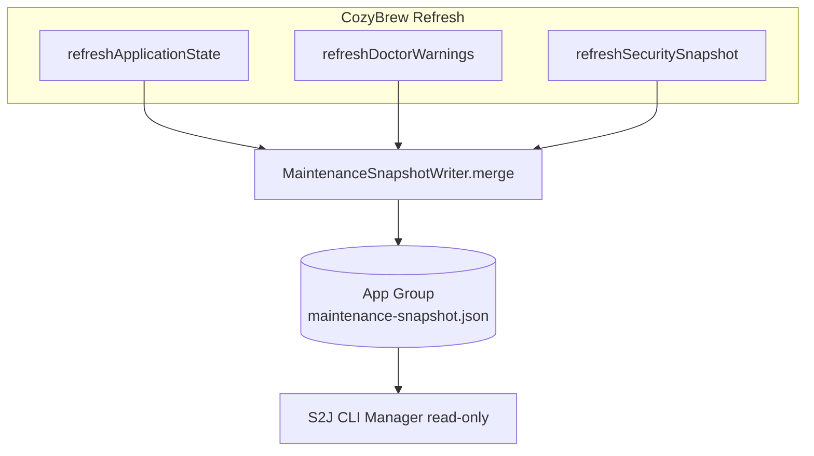

# S2J CozyBrew — Issue `#21`: メンテナンス状態の共有 (`#22` vulns 軸を含む契約)

> **状態:** ドラフト (`docs_mod`)。GitHub [#21](https://github.com/stein2nd/s2j-cozy-brew/issues/21)。  
> **関連:** [#22 `brew vulns`](brew-vulns-spec.md) — スナップショットは **初版から vulns フィールドを予約** し、手戻りを避ける。

### 方針確定 (#21)

* **同一 Mac 上の S2J アプリ間で共有する「メンテナンス状態」の正本** は **App Group コンテナ** とする (状態マシンの実体 = コンテナ内 JSON の読み書き・バージョン遷移)。
* CozyBrew が Refresh 成功時に **遷移 (スナップショット更新 + `delta`)** を書き、[S2J CLI Manager](https://github.com/stein2nd/s2j-cli-manager) 等は **起動なしで最終状態を観測** する。
* 本文の **モジュール名、App Group ID、URL スキーム、型名** はすべて **仮** (リリース前に確定)。一覧は §1.1。

---

## 1. 原則

| 原則 | 内容 |
| --- | --- |
| **正本** | Homebrew の操作、Refresh は **CozyBrew のみ**。[S2J CLI Manager](https://github.com/stein2nd/s2j-cli-manager) は **読取 + 画面誘導** |
| **canonical** | 件数、「新規発生」は CozyBrew が書いた **`maintenance-snapshot.json`** (Refresh 時 `delta`) |
| **provisional** | [S2J CLI Manager](https://github.com/stein2nd/s2j-cli-manager) の **staleness プローブ** (スナップショット古さの推定) は表示ラベルで区別 (本 Issue 外、[S2J CLI Manager](https://github.com/stein2nd/s2j-cli-manager) 実装) |
| **分離** | Homebrew 行と npm / Composer audit は **別行・合算しない** |
| **表面** | **Public** = スナップショット読取、Custom URL。**SPI** = delta / fingerprint 算出 (`BrewManager` は公開しない) |
| **状態マシン** | 明示的な XPC 状態機ではなく、**App Group 上の `maintenance-snapshot.json` / `user-state.json` が canonical 状態**。遷移イベント = CozyBrew の各 Refresh 成功 (§5) |

### 1.1. 仮称一覧 (draft / temporary names)

実装、Entitlements、リポジトリ分割前の **作業名** です。確定後は本節とコードから一括リネームします。

| 区分 | 仮称 | 備考 |
| --- | --- | --- |
| App Group ID (案) | `group.com.s2j.maintenance` | `com.apple.security.application-groups` |
| コンテナ内ディレクトリ (案) | `S2JMaintenance/` | 正規パス = `…/Group Containers/<App Group ID>/S2JMaintenance/` |
| スナップショットファイル | `maintenance-snapshot.json` | schema `schemaVersion` で版管理 |
| ユーザー baseline | `user-state.json` | acknowledged + fingerprint (系ごと) |
| 共有 SPM (案) | **`S2JMaintenanceKit`** | DTO、decode、Writer インターフェース、パス解決 |
| Swift SPI 名 (案) | **`S2JCollaboration`** | `@_spi(S2JCollaboration)` — delta / fingerprint **のみ** |
| Writer (案) | `MaintenanceSnapshotWriter` | CozyBrew 内、将来 Kit に寄せる |
| ドメイン DTO (案) | `BrewMaintenanceSnapshot` | JSON 型名；`Brew*` は Homebrew 軸の意味 |
| `producer` フィールド | `"com.s2j.cozyBrew"` | スナップショット生成元アプリ ID (仮) |
| Custom URL スキーム | `s2j-cozy-brew://` | 例: `…/open/security` |

`Application Support` 直下への配置は **`#21` では採用しません** (App Group が正本)。開発中のみ **同一マシン、Entitlement 未付与** のローカル検証用に、環境変数や Preview 用の in-memory バックエンドを許容する場合は **スキーマ同一・パス解決だけ差し替え** とし、仕様上の状態マシンは App Group 前提のまま据え置きます。

---

## 2. App Group 上の状態ストア

### 2.1. レイアウト (正本)

```
<Group Containers>/<App Group ID>/
  S2JMaintenance/
    maintenance-snapshot.json    # canonical 件数・鮮度・delta・fingerprints
    user-state.json              # ユーザー acknowledged baseline (両アプリ対等 R/W)
```

* **読取:** [S2J CLI Manager](https://github.com/stein2nd/s2j-cli-manager) 等は **App Group entitlement 付与** のうえ、`S2JMaintenanceKit` (仮) のパス API で開く。
* **書込:** v1では **CozyBrew のみ** が `maintenance-snapshot.json` を更新 (§5)。`user-state.json` は CozyBrew と [S2J CLI Manager](https://github.com/stein2nd/s2j-cli-manager) が **契約に従い対等** に更新しうる。

### 2.2. 状態マシンとしての解釈

| 概念 | 実装対応 |
| --- | --- |
| **状態** | 直近の `maintenance-snapshot.json` + 参照される `user-state.json` |
| **遷移** | `refreshApplicationState` / `refreshDoctorWarnings` / `refreshSecuritySnapshot` の **いずれか成功** → Writer が merge → 原子的 replace |
| **観測** | 他アプリはファイル mtime / `generatedAt` / `freshness.*At` を読む (プロセス間通知は v1必須ではない) |
| **「新規」表示** | Refresh 由来の `delta` が canonical、staleness プローブは provisional (§1) |

CozyBrew 未起動でも **最後に書かれたスナップショットが状態** として残る点が、App Group を選んだ理由です。

### 2.3. Entitlements (両アプリ)

* 仮 App Group ID は §1.1。CozyBrew と [S2J CLI Manager](https://github.com/stein2nd/s2j-cli-manager) の **同一 Team、同一 Group ID** を契約条件とする。
* 詳細な provisioning / sandbox 例外は実装 Issue で追記 (本ドラフトでは ID の仮置きのみ)。

---

## 3. `BrewMaintenanceSnapshot` (schema v1)

* **`schemaVersion`:** `1`
* **`producer`:** `"com.s2j.cozyBrew"` (固定)
* 書き込み: **原子的置換** (temp + `replaceItemAt`)

### 3.1. JSON 骨格 (例)

```json
{
  "schemaVersion": 1,
  "producer": "com.s2j.cozyBrew",
  "generatedAt": "2026-11-27T06:00:00Z",
  "previousGeneratedAt": "2026-11-26T06:00:00Z",
  "brewVersion": "5.0.6",
  "counts": {
    "outdatedFormulae": 3,
    "outdatedCasks": 1,
    "doctorWarnings": 0,
    "vulnerableFormulaCount": 2,
    "openVulnerabilityCount": 5
  },
  "freshness": {
    "outdatedAt": "2026-11-27T05:58:00Z",
    "doctorAt": "2026-11-27T05:50:00Z",
    "vulnsAt": "2026-11-27T06:00:00Z"
  },
  "complete": {
    "vulnsScan": true
  },
  "capabilities": {
    "vulnsCommand": true
  },
  "delta": {
    "outdatedFormulaeAdded": ["foo"],
    "outdatedFormulaeRemoved": [],
    "doctorWarningsDelta": 0,
    "vulnerableFormulaeAdded": ["bar"],
    "vulnerableFormulaeRemoved": [],
    "openVulnerabilityCountDelta": 2
  },
  "fingerprints": {
    "outdated": "sha256:…",
    "doctor": "sha256:…",
    "vulns": "sha256:…"
  }
}
```

### 3.2. フィールド意味

| 区分 | フィールド | 更新トリガー |
| --- | --- | --- |
| メタ | `generatedAt`、`previousGeneratedAt`、`brewVersion` | いずれか軸の **成功 Refresh** ごとにスナップショット全体を再生成 |
| 件数 | `counts.*` | 各軸の **最新の成功状態** と一致 (`BrewManager` と乖離禁止) |
| 鮮度 | `freshness.*At` | 当該軸の最終の成功時刻 |
| 品質 | `complete.vulnsScan`、`capabilities.vulnsCommand` | [brew-vulns-spec.md §4.4](brew-vulns-spec.md) |
| 差分 | `delta.*` | **直前スナップショット** との diff (初回は空配列 / 0で固定) |
| 指紋 | `fingerprints.*` | 下記 §4 |

**`#22` 未実装期間:** `vulnerableFormulaCount` / `openVulnerabilityCount` は `null`、`freshness.vulnsAt` は省略可、`capabilities.vulnsCommand` は `false`。[S2J CLI Manager](https://github.com/stein2nd/s2j-cli-manager) は **null を「未取得」** と表示。

---

## 4. fingerprint 算出 (SPI 共有)

同一ロジックを **CozyBrew と [S2J CLI Manager](https://github.com/stein2nd/s2j-cli-manager) がコピーしません**。名称 **`S2JCollaboration` / `S2JMaintenanceKit` は仮です** (§1.1)。

| 段階 | 置き場 |
| --- | --- |
| P0〜 P2 | `CozyBrewCore` 内 `@_spi(S2JCollaboration)` (仮。または `Collaboration/` サブフォルダー) |
| P4以降 | 共有 SPM **`S2JMaintenanceKit`** (仮)。App Group パス解決、decode、SPI を集約 |

| 軸 | 入力 (canonical) | 算出 (案) |
| --- | --- | --- |
| `outdated` | ソート済み outdated formula + cask **name@version** 列 | `SHA-256` hex |
| `doctor` | Warning `title` 列 (順序依存を避けるためソート) | `SHA-256` hex |
| `vulns` | ソート済み `(formula, openVulnerabilityId)*` | `SHA-256` hex、`complete == false` でも算出可だが `user-state` 更新は UI で注意表示 |

`user-state.json` では系ごとに `acknowledgedAt` + **当時の fingerprint** を保存 (詳細は両リポジトリ SPEC で参照リンク)。CozyBrew は **Refresh 成功後** に brew 系3fingerprint の **最新値** を書き換えうる (確認済み baseline の無効化を UI で通知)。

---

## 5. 誰がいつ書き込むか

| イベント | 更新する `counts` / `freshness` | `delta` |
| --- | --- | --- |
| `refreshApplicationState()` 成功 | outdated (+ taps は counts 外でも可、v1は outdated のみ必須) | outdated 軸 |
| `refreshDoctorWarnings()` 成功 | doctor | doctor 軸 |
| `refreshSecuritySnapshot()` 成功 | vulns | vulns 軸 |
| 部分的失敗 | 成功した軸のみ更新；失敗軸は **前回スナップショット値を維持** |

**実装手戻り防止:** P1 (`#22` コア) の段階で `MaintenanceSnapshotWriter` を導入し、doctor / outdated は **既存 Refresh からも呼ぶ** (最初は vulns フィールド null のまま)。



---

## 6. Public API 表面

| 種別 | 内容 | 消費者 |
| --- | --- | --- |
| ファイル読取 | `maintenance-snapshot.json` decode | [S2J CLI Manager](https://github.com/stein2nd/s2j-cli-manager) |
| Custom URL (仮) | `s2j-cozy-brew://open/outdated` / `…/warnings` / `…/security` | [S2J CLI Manager](https://github.com/stein2nd/s2j-cli-manager)、Spotlight 等 |
| 起動不要 | 最終スナップショットはディスクに残る | ダッシュボード |

**公開しない:** `BrewManager`、`brew` subprocess、delta ロジックの重複実装。

---

## 7. CLI Manager ダッシュボード行 (契約)

| 行 | データ源 | 表示例 |
| --- | --- | --- |
| Homebrew Outdated | `counts.outdated*` + `freshness.outdatedAt` | 独立行 |
| Homebrew Warnings | `counts.doctorWarnings` | doctor ≠ CVE |
| Homebrew Security | `counts.vulnerableFormulaCount`, `openVulnerabilityCount`, `complete.vulnsScan` | **`#22` 実装後のみ** |
| npm / Composer | 各アプリ自前 audit | Homebrew と **合算しない** |

`delta.vulnerableFormulaeAdded` 等で「新規」ハイライト (canonical)。staleness プローブ結果は **「推定」** ラベル ([S2J CLI Manager](https://github.com/stein2nd/s2j-cli-manager) 側仕様)。

---

## 8. 実装段階と `#22` の接続 (手戻り最小化)

| 順 | 作業 | `#21` | `#22` |
| --- | --- | --- | --- |
| 1 | schema v1 + Writer 骨格 + fingerprints SPI (vulns null) | ○ | 型だけ先行 |
| 2 | `BrewVulnsParser` + `refreshSecuritySnapshot` | Writer に vulns 軸接続 | ○ |
| 3 | Security UI + サイドバーバッジ | 件数一致テスト | ○ |
| 4 | **App Group** Entitlements + [S2J CLI Manager](https://github.com/stein2nd/s2j-cli-manager) 読取 (`S2JMaintenanceKit` 仮) | ○ | フィールドそのまま |
| 5 | `user-state` 読み書き | ○ | `fingerprints.vulns` |

**避けること (Bad):** `#22` で UI だけ先に作り、件数をローカル computed のみに置いてスナップショットを後付け。  
**推奨:** [README.md 実装順](README.md) の P0→ P3で **Writer と件数定義を doctor/outdated と同時にそろえる**。

---

## 9. Acceptance Criteria (追跡用)

Issue `#21` チェックリストとの対応:

| 区分 | 本ドラフト |
| --- | --- |
| ドキュメント | 本ファイル §2–§7、昇格後 `docs/maintenance_snapshot_spec.md` 新設候補 |
| CozyBrew 実装 | §5 (Writer)、§4 (SPI)、Refresh フック |
| `#22` 連携 | §3 (vulns フィールド)、[brew-vulns-spec.md §3](brew-vulns-spec.md) 件数定義 |
| 非目標 | [S2J CLI Manager](https://github.com/stein2nd/s2j-cli-manager) staleness 実装、iCloud |

---

## 10. 参照

* [#22 仕様](brew-vulns-spec.md)
* 現行 `BrewEnvironmentSnapshot` — **「環境」画面専用** であり、本スナップショットとは別物 (混同禁止)
* `NotificationCenter` `cozyBrewNavigateToWarnings` — 同一プロセス UI のみ；本契約の外部 API ではない
